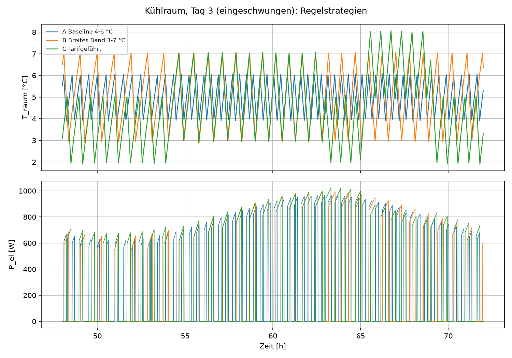
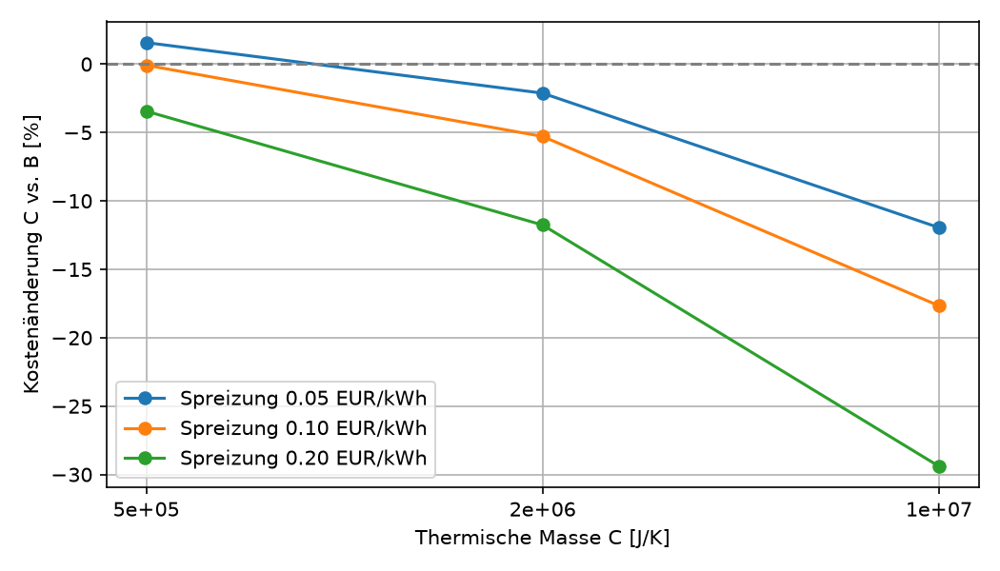

## Simulation

`python/simulate.py` simulates 3 days (30 s communication step) with a
sinusoidal ambient temperature (mean 18 °C, amplitude 7 K) and an
**illustrative** time-of-use tariff (mean 0.30 EUR/kWh, +/- spread in the
peak 17-21 h and off-peak 21-06 h windows; not real market data). Only day 3
is evaluated, so the initial cool-down is excluded. Costs are corrected for
the stored-energy drift over the day.

Three strategies (all two-point control with a temperature band):

- **A** baseline: 4-6 °C
- **B** wide band: 3-7 °C
- **C** tariff-driven: pre-cools to 2-5 °C in the off-peak window and shortly
  before the peak, and lets the room warm up to 5-8 °C during the peak.
  The switching hours were set by hand, not optimised.

**Base case (C = 5e5 J/K, spread 0.10 EUR/kWh, day 3):**

| Strategy | kWh | Cost [EUR] | Switches |
|---|---|---|---|
| A baseline | 7.30 | 2.158 | 114 |
| B wide band | 7.30 | 2.164 | 59 |
| C tariff-driven | 7.52 | 2.162 | 70 |

For this small room, tariff-driven control does not pay off: costs are equal
and energy use is 3 % higher (pre-cooling at a lower COP). The wider band
roughly halves the number of compressor starts.

**Cost of C relative to B, by thermal mass and tariff spread:**

| C [J/K] | spread 0.05 | 0.10 | 0.20 EUR/kWh |
|---|---|---|---|
| 5e5 | +1.6 % | -0.1 % | -3.4 % |
| 2e6 | -2.1 % | -5.3 % | -11.8 % |
| 1e7 | -12.0 % | -17.7 % | -29.4 % |

Pre-cooling only pays off when the room (or its contents) stores enough
thermal energy and the tariff spread is large enough.

