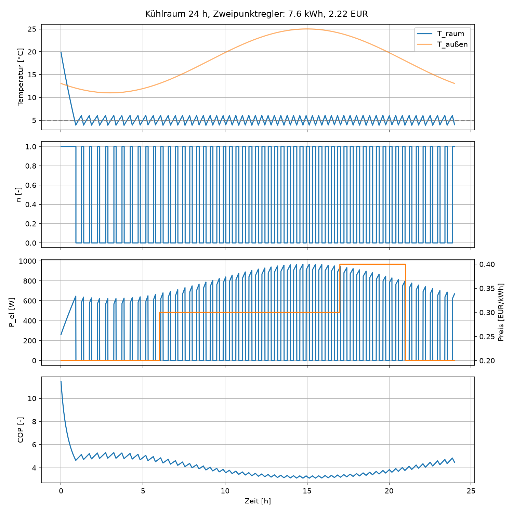

# Cold Room Simulation: OpenModelica FMU + Python Co-Simulation

A small, reproducible workflow for simulating a refrigerated room in
OpenModelica, exporting it as an FMI 2.0 Co-Simulation FMU and controlling it
from Python with `fmpy`. No commercial licences required.

## Model

`modelica/Kuehlraum.mo` is a lumped (0D) model of a cold room with a
refrigeration unit:

- Room as one thermal mass: `C * dT/dt = UA * (T_amb - T) + Q_load - Q0`
- Cooling capacity `Q0 = n * Q0_nom`, with `n` in [0, 1]
- COP from a Carnot approach with efficiency factor:
  `COP = eta_c * T_0 / (T_c - T_0)`, where `T_0 = T - dT_ev` and
  `T_c = T_amb + dT_cd`
- Electrical power `P_el = Q0 / COP`

**FMU interface**

| Name | Causality | Meaning |
|---|---|---|
| `n` | input | relative compressor speed (0..1) |
| `T_amb` | input | ambient temperature [K] |
| `T_raum_out` | output | room temperature [K] |
| `COP` | output | coefficient of performance [-] |
| `P_el` | output | electrical power [W] |

Parameters: C = 5e5 J/K, UA = 50 W/K, Q_load = 500 W, Q0_nom = 3000 W,
eta_c = 0.45, dT_ev = 8 K, dT_cd = 10 K.

## Simulation

`python/simulate.py` runs a 24 h scenario (30 s communication step) with a
sinusoidal ambient temperature (mean 18 °C, amplitude 7 K) and an
**illustrative** time-of-use tariff (0.20 / 0.30 / 0.40 EUR/kWh; not real market
data). Baseline controller: two-point control, setpoint 5 °C ± 1 K.

**Baseline result (24 h):** 7.6 kWh, 2.22 EUR. The room reaches the setpoint
after about 0.9 h and then cycles. The COP varies between about 3.3 (afternoon)
and about 5 (night), and compressor power peaks at about 950 W around 15:00.



## Limitations

- Simplified model: the COP does not depend on part load, so variable speed
  brings no efficiency gain here. Savings can only come from the time-varying
  ambient temperature and tariff.
- Constant load, no defrost, no refrigerant cycle dynamics.
- Parameters are plausible, not validated against measurements.

## Run it

```bash
python3 -m venv .venv && source .venv/bin/activate
pip install fmpy numpy matplotlib
python3 python/simulate.py
```

The FMU was built with OpenModelica 1.26.3 for Linux (`binaries/linux64`).
To use another OS, re-export `modelica/Kuehlraum.mo` as FMI 2.0 Co-Simulation.

## Roadmap

- Price-aware setpoint band (pre-cooling) vs. baseline
- Model predictive control / reinforcement learning against the same FMU